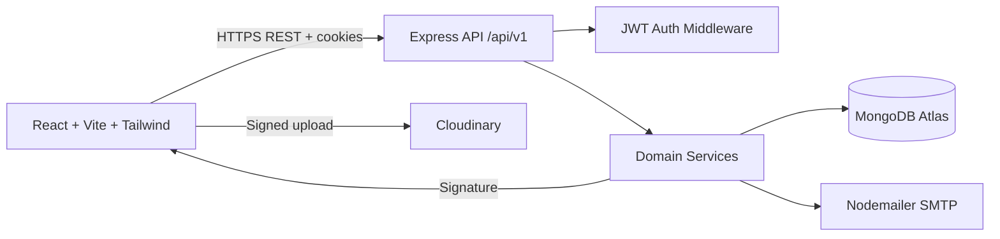
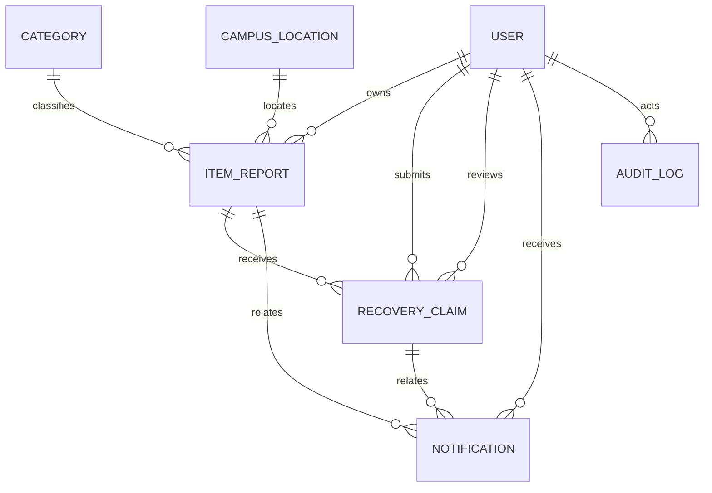
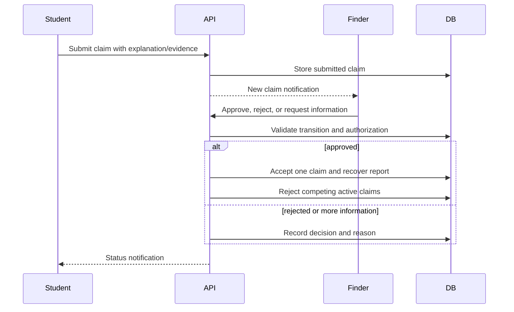
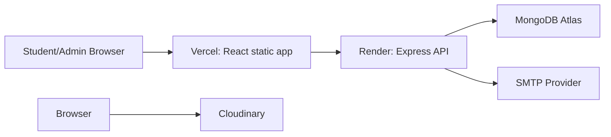

# System Architecture

## Runtime architecture



The frontend never receives JWT refresh tokens or Cloudinary API secrets. The backend signs Cloudinary uploads and controls authorization.

## Backend layers

```text
Route
  -> validation middleware
  -> authentication/role middleware
  -> controller
  -> service
  -> Mongoose model
  -> notification/audit side effects
```

Important services:

- `auth.service.js`: registration, verification, JWT sessions, password lifecycle.
- `report.service.js`: report lifecycle, ownership, moderation, image references.
- `matching.service.js`: transparent weighted lost/found matching.
- `claim.service.js`: claim transitions and recovery.
- `notification.service.js`: ownership-scoped notification operations.
- `admin.service.js`: dashboard aggregation, moderation, user administration.

## Domain relationships



## Recovery workflow



## Deployment architecture



## Roles

- `student`: create reports and claims, manage own resources.
- `moderator`: review reports and claims, inspect platform activity.
- `admin`: all moderator actions plus user management and dashboard access.
