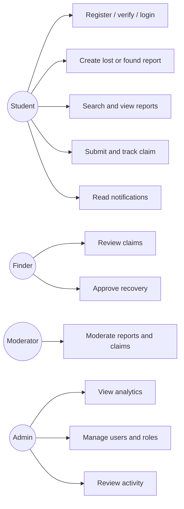
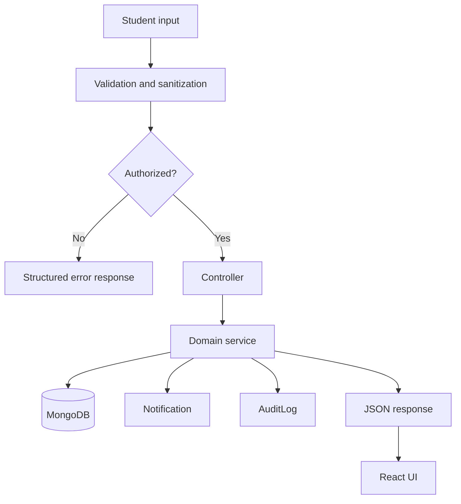

# College Demonstration Preparation

## Synopsis

Smart Campus Lost-and-Found Portal is a secure web platform for reporting, discovering, claiming, and recovering items lost on a university campus. It combines searchable reports, transparent matching, evidence-based claims, notifications, and role-based moderation in one system.

## Modules

1. Authentication and profiles
2. Lost and found reporting
3. Search and filtering
4. Smart rule-based matching
5. Claims and recovery
6. Notifications
7. Administration and moderation
8. Audit logging

## Use-case diagram

## Data-flow diagram

## Suggested demonstration sequence

1. Register a student and show domain/password validation.
2. Verify the account using the development email link or SMTP inbox.
3. Create a lost report with identifying attributes.
4. Create a second student account and submit a matching found report.
5. Open the dashboard and show the potential match.
6. Submit a claim with an ownership explanation.
7. As the finder, request more information and then approve the claim.
8. Show the recovered report, notifications, and audit activity.
9. Open the admin dashboard and demonstrate moderation and user controls.

## Viva questions and answers

### Why use JWT and refresh-token rotation?

Short-lived access tokens reduce exposure time. Rotating HTTP-only refresh cookies prevent a stolen refresh token from being reused indefinitely and allow reuse detection.

### Why are claims reviewed instead of automatically accepted?

Matching is only a discovery aid. Ownership requires human review of the claimant's explanation and evidence, so the system never treats a match as proof.

### How are users prevented from modifying other users' reports?

Authentication identifies the actor, and the service checks report ownership or moderator/admin role before applying mutations.

### How is the last administrator protected?

Role and status changes count active administrators before applying a change. A request that would leave zero active administrators is rejected.

### How are image secrets protected?

The backend creates a short-lived signed Cloudinary upload request. The browser receives only the signature and public upload parameters; the Cloudinary API secret remains server-side.

### What happens when a claim is approved?

The selected claim is accepted, the report is marked recovered, competing active claims are rejected, notifications are created, and an audit record is written. Transactions are used when supported.

### Why use a rule-based matching algorithm?

It is transparent, deterministic, configurable, and free of paid AI dependencies. Each result includes a score and matching reasons.

### What is the role separation?

Students manage their own reports and claims, moderators review platform content, and administrators additionally manage users and platform analytics.

## Future scope

- SSO and campus directory integration
- Real-time WebSocket notifications
- Optional semantic matching
- In-app messaging
- Dedicated abuse-report workflow
- Privacy retention policies and analytics exports
